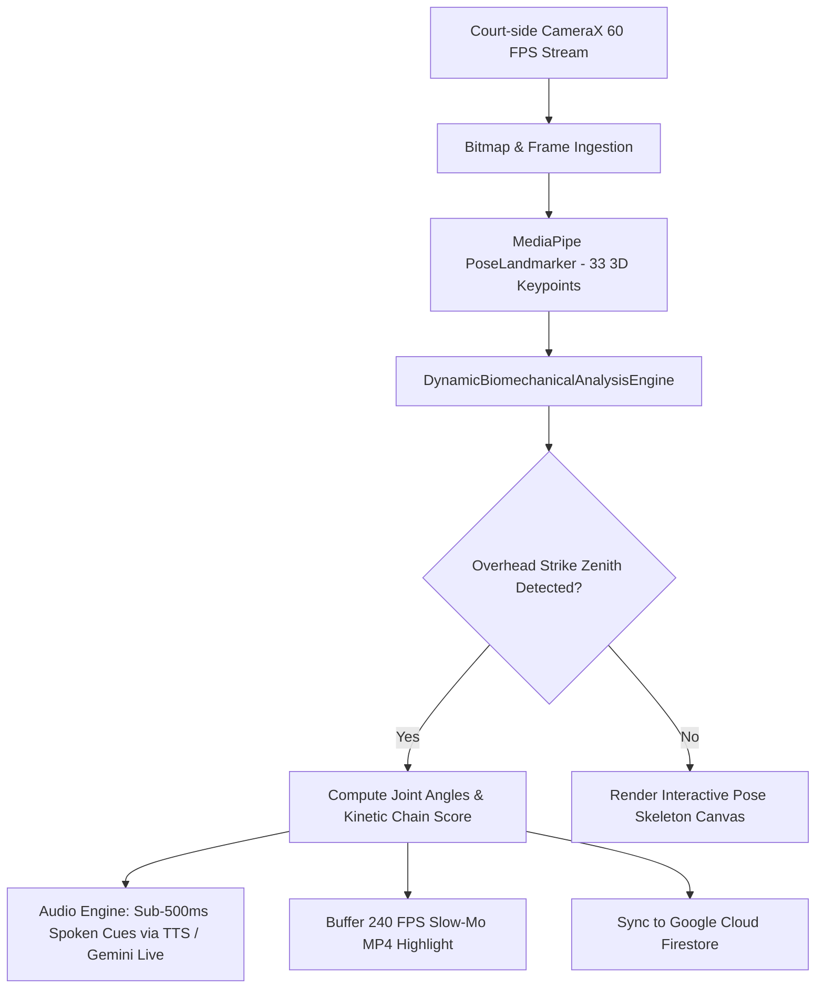

# AceAI - Smart AI-Powered Badminton Biomechanical Coaching & Real-time Stroke Analytics System

<div align="center">
  <h3>Olympic-Caliber Biomechanical Telemetry & Conversational AI Coaching on Commodity Smartphones</h3>
  <p><b>Course:</b> 21CS601 - Design Thinking and Innovation in Engineering</p>
  <p><b>Repository:</b> <a href="https://github.com/abhisheikraja2007-droid/DT---Batminton">DT---Batminton</a> | <b>Demo Video:</b> <a href="https://drive.google.com/file/d/11Bh4mi2BMfjptMPx0DiyxvauRImfQfLy/view?usp=drive_link">Google Drive Demonstration</a></p>
</div>

---

## 🏸 Project Overview

**AceAI** is an edge-native Android sports science and coaching platform engineered to democratize high-performance badminton stroke analysis. By pairing markerless monocular computer vision with conversational multimodal artificial intelligence, AceAI provides real-time biomechanical feedback during live court drills without requiring any wearable sensors, smart rackets, or laboratory motion capture rigs.

### 🌟 Key Highlights
- **100% Markerless Optical Pose Tracking:** Powered by Google MediaPipe Tasks Vision (33 3D skeletal landmarks) at sustained 30–60 FPS.
- **Dynamic Biomechanical Kinematic Engine:** Measures 3D joint angles (shoulder abduction, elbow extension, wrist pronation velocity), contact zenith apex reach, and multi-segment kinetic chain sequencing ($Legs \rightarrow Hips \rightarrow Torso \rightarrow Shoulder \rightarrow Wrist$).
- **Sub-500ms Audio Feedback:** Real-time spoken technique corrections delivered directly to the athlete's wireless Bluetooth earbuds (e.g., *"Raise your elbow 15 degrees higher on the backswing!"*).
- **Gemini 2.0 Flash Conversational Voice Coach:** Bidirectional 16 kHz PCM WebSocket streaming enabling hands-free conversational dialogue with *Coach Maya*.
- **Automated 240 FPS Slow-Motion Highlight Clipping:** Continuous rolling frame ring buffer automatically saves high-speed MP4 replays synchronized to stroke impact timestamps.
- **Cloud & Offline Persistence:** Google Cloud Firestore synchronization paired with AndroidX Room SQLite local caching.

---

## 🏛️ System Architecture



---

## 📊 Design Thinking Documentation & Artifacts

The complete academic Design Thinking Report adhering to institutional formatting standards is available in the root directory:
- 📄 **[AceAI_Badminton_Coach_Design_Thinking_Report.docx](AceAI_Badminton_Coach_Design_Thinking_Report.docx)** *(Chapters 1–9, 30 Tables, 8 Realistic Figures, Annexure & Appendices A–G)*
- 🎥 **[Google Drive Video Demonstration](https://drive.google.com/file/d/11Bh4mi2BMfjptMPx0DiyxvauRImfQfLy/view?usp=drive_link)**

### Evaluated Badminton Strokes
1. **Forehand Jump Smash** (Benchmark: 116° elbow extension, 240+ km/h exit speed)
2. **Attacking Forehand Clear** (Benchmark: 122° elbow extension, high trajectory clearance)
3. **Deceptive Fast Drop Shot** (Benchmark: 112° elbow angle, steep downward angle)
4. **Forehand Net Kill / Tap** (Benchmark: 98° elbow angle, rapid frontcourt wrist snap)
5. **Flat Drive Exchange** (Benchmark: 104° elbow angle, waist-height trajectory)
6. **Defensive Forehand Lift** (Benchmark: 135° elbow angle, deep underhand recovery)

---

## 📱 Tech Stack & Dependencies

- **Platform:** Android 14 (API Level 34), Min SDK 26 (Android 8.0)
- **Language & Runtime:** Kotlin 2.0.0, Kotlin Coroutines & StateFlow
- **Computer Vision:** Google MediaPipe Tasks Vision (`com.google.mediapipe:tasks-vision:0.10.14`)
- **Camera Ingestion:** AndroidX CameraX 1.4.0 (`camera-core`, `camera2`, `camera-lifecycle`, `camera-view`)
- **Multimodal AI:** Google Gemini 2.0 Flash (`gemini-2.0-flash`) via WebSocket Streaming
- **Database & Cloud:** Google Cloud Firestore 25.1.0, Firebase Authentication 23.0.0, AndroidX Room SQLite 2.6.1
- **UI Framework:** Jetpack Compose BOM 2024.09.00, Material 3 Design System

---

## 🚀 Getting Started

### Prerequisites
- [Android Studio Ladybug / Koala](https://developer.android.com/studio)
- JDK 17+
- Android Device with Camera2 API support (Google Pixel 7 / Samsung Galaxy S22+ recommended)

### Setup
1. Clone the repository:
   ```bash
   git clone https://github.com/abhisheikraja2007-droid/DT---Batminton.git
   cd DT---Batminton
   ```
2. Open the project in Android Studio.
3. Configure your API key in `.env` (or set `GEMINI_API_KEY` in `local.properties`):
   ```properties
   GEMINI_API_KEY=your_gemini_api_key_here
   ```
4. Sync Gradle and run on a connected Android smartphone or emulator.

---

## 👥 Student Project Team & Mentorship
- **Student Lead:** Abhisheik Raja S (Lead AI & Mobile Systems Engineer)
- **Institution:** Department of Computer Science and Engineering
- **Course:** 21CS601 - Design Thinking and Innovation in Engineering
